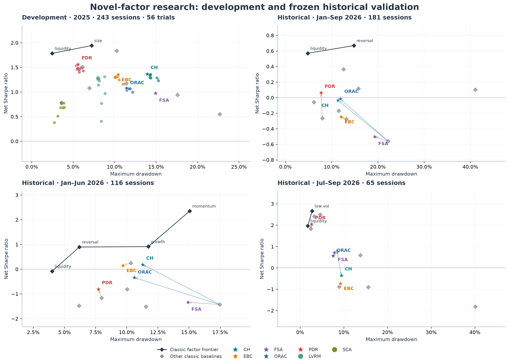

# 因子演化：七路独立研究与冻结历史验证

本研究在现有 A 股回测系统上，由 1 个 alpha 聊天协调 7 个独立研究聊天和 1 个独立审计聊天，完成两轮、共 56 个新构造候选。2025 年开发期中，33 个候选相对各自固定基准取得夏普与回撤的 Pareto 改善；研究者据此提交 5 个冻结提名，另外 2 路提交空提名。

以下是 2026-01-05 至 2026-09-30 的连续账户结果。所有数值都扣除系统记录的交易费用；最大回撤以正值表示跌幅，数值越小越好。

| 候选 | 固定基准 | 净夏普：候选 / 基准 | 最大回撤：候选 / 基准 | 净区间收益：候选 / 基准 |
| --- | --- | --- | --- | --- |
| CH | investment | -0.0364 / -0.5602 | 11.39% / 22.23% | -1.40% / -9.55% |
| EBC | quality | -0.2471 / -0.2757 | 12.06% / 13.21% | -4.24% / -4.72% |
| FSA | investment | -0.5018 / -0.5602 | 19.33% / 22.23% | -8.07% / -9.55% |
| ORAC | investment | -0.0169 / -0.5602 | 11.89% / 22.23% | -0.95% / -9.55% |
| PDR | dividend | 0.0613 / -0.2646 | 7.73% / 7.98% | 0.10% / -2.08% |

合并期中，五个候选均改善了各自基准的夏普与回撤。分阶段看，PDR 在 7—9 月的夏普较高、回撤也较大；CH、ORAC、FSA 在该阶段的夏普低于 investment，EBC 在两个阶段分别呈现夏普或回撤权衡。PDR 合并净收益为 0.10%，其余四个候选的合并净收益为负。十个经典因子中的 liquidity 在合并期的夏普与回撤均优于这五个候选。

已有报告曾展示相同历史区间，因此本研究采用**探索性历史验证**口径。候选的经济解释与构造新颖性属于研究假设，后续结论需要新观察支持。

| 阅读入口 | 内容 |
| --- | --- |
| [完整研究报告](reports/RESULTS.md) | 分阶段结果、压力、敏感度、不确定性、经典因子前沿与归因 |
| [全部开发候选](reports/DEVELOPMENT.md) | 56 次候选的实际开发表现与对应完整规格 |
| [审计与完整性记录](reports/AUDIT.md) | 因果性、复现、尝试计数、PDR 口径核对与适用范围 |
| [校验与数据说明](REPRODUCE.md) | 汇总文件校验、历史计算环境与输入要求 |
| [候选汇总](data/candidates.csv) | 56 个候选的参数、开发指标、基准与提名状态 |
| [冻结比较](data/nominees.csv) | 五个提名与基准的合并及分阶段汇总指标 |

研究脉络：[第六讲「进化」讨论](https://github.com/aslan9/pku_quantllm/issues/10)。经典因子与底层系统：[factor-search](https://github.com/celestial-toymaker/factor-search)。协作技能：[Project Structure](https://github.com/celestial-toymaker/project-structure-skill)。
